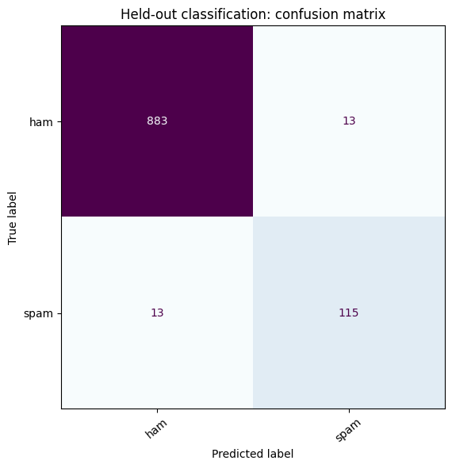
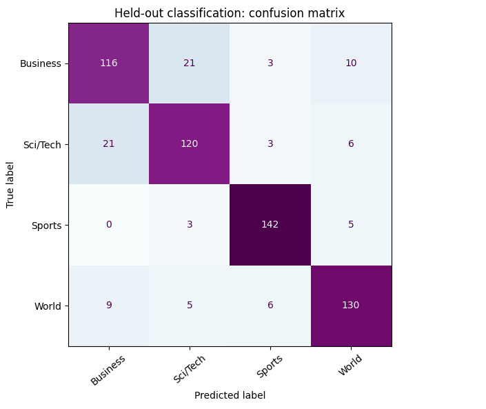
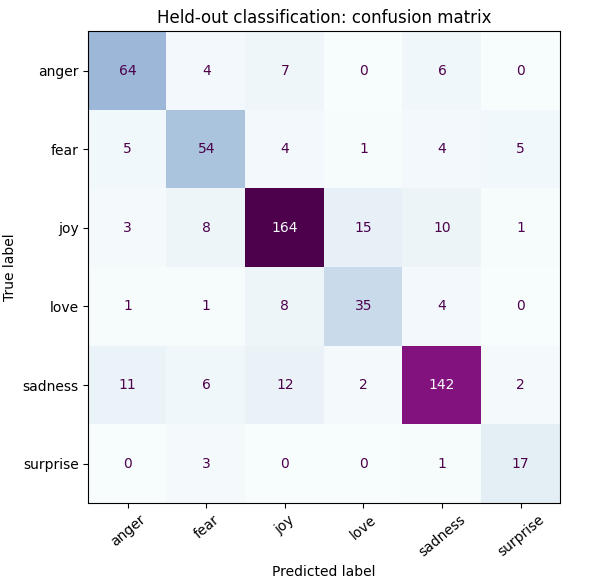
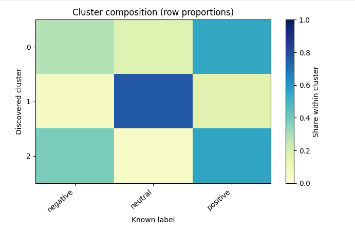
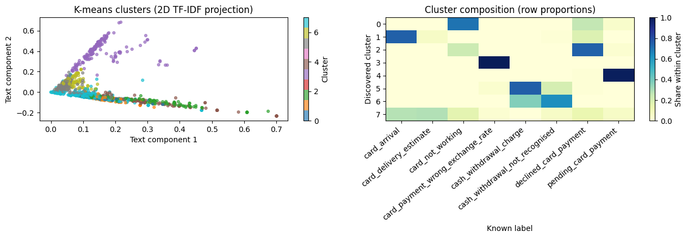

# Text Mining

**Applied natural language processing, machine learning, and responsible AI**

Six hands-on, graduate-level projects developed for the **DTAN-520 Text Mining residency (Fall 2026)** at Indiana Wesleyan University. Each project connects exploratory text analysis with predictive modeling, interpretation, and evidence-based organizational decisions.

## Projects

| Project | Focus | Research question | Materials |
|---|---|---|---|
| **01 · Spam Detection** | Classify SMS messages as spam or legitimate | How can organizations identify suspicious messages while limiting false alarms? | [Open folder](Group01_Spam_Detection/) |
| **02 · News Classification** | Categorize news articles | How reliably can text mining organize news into meaningful categories? | [Open folder](Group02_News_Classification/) |
| **03 · Online Discussions** | Classify and cluster discussion posts | What topics and patterns emerge from online discussions? | [Open folder](Group03_Online_Discussions/) |
| **04 · Emotion Recognition** | Classify emotion in short texts | When should organizations trust automated emotion predictions? | [Open folder](Group04_Emotion_Recognition/) |
| **05 · Financial News Sentiment** | Analyze financial news sentiment | Can automated financial sentiment safely inform business decisions? | [Open folder](Group05_Financial_News_Sentiment/) |
| **06 · Banking Chatbot Intents** | Classify customer service requests | How can banks route questions accurately and know when to escalate to a person? | [Open folder](Group06_Banking_Chatbot_Intent/) |

Each folder includes a **Jupyter notebook (`.ipynb`)**, an **executed HTML report**, a **CSV dataset**, and a **student sample-prompts PDF**. Dataset availability and reuse remain subject to the original dataset terms.

## Analytical workflow

**Explore the text → Build and evaluate models → Recommend responsible action**

1. **Explore:** Inspect the dataset, examine label distributions and text lengths, and interpret term frequency–inverse document frequency (TF-IDF) features.
2. **Model:** Apply TF-IDF with logistic regression; evaluate held-out predictions using precision, recall, F1, and confusion matrices. Explore themes with K-means clustering.
3. **Decide:** Connect observed findings to an organizational recommendation, acknowledge uncertainty and misclassification risks, and propose safeguards and human oversight.

## Selected visualizations

The figures below are **actual outputs from the executed project notebooks**. They illustrate model evaluation and exploratory clustering, not production readiness. Results depend on the data and experimental settings documented in each project.

| Group 1 · Spam detection | Group 2 · News classification |
|---|---|
|  |  |
| **Reading:** Inspect false positives and false negatives before recommending automated filtering. | **Reading:** Compare correct predictions and confusion between news categories. |

| Group 4 · Emotion recognition | Group 5 · Financial news sentiment |
|---|---|
|  |  |
| **Reading:** Compare errors across emotions rather than relying on overall accuracy alone. | **Reading:** Cluster membership and known sentiment labels do not necessarily align. |

**Group 6 · Banking chatbot intent clustering**

**Reading:** A two-dimensional projection is a simplified view of high-dimensional text features. Visual separation does not establish that clusters correspond to known customer intents.

The [Group 3 online discussions project](Group03_Online_Discussions/) also includes classification and clustering results in its notebook and executed HTML report. Additional Group 2, 4, and 5 visualizations are available in their respective reports.

## Getting started

1. Open a project folder and read its sample-prompts PDF and notebook introduction.
2. Download the notebook (`.ipynb`) and corresponding CSV file into the same working directory, or upload both to **Google Colab**.
3. Run notebook cells in order. Use the executed HTML report to inspect a saved example of the analysis.
4. Interpret your own outputs, cite supporting evidence, and distinguish observations from assumptions.

**Software:** Python, Jupyter Notebook or Google Colab; commonly used libraries include pandas, scikit-learn, matplotlib, and seaborn. See each notebook for its specific imports and instructions.

## Responsible use and academic integrity

The projects are educational demonstrations, not validated operational systems. Predictive scores do not establish fairness, causality, or deployment safety. Students are encouraged to use AI assistants to question their interpretations and troubleshoot code, **not to generate finished presentations or fabricate findings**. Do not upload private information or credentials.

## Attribution and license

**Prepared by Dr. Eskinder Belete**, Adjunct Faculty, Indiana Wesleyan University, for DTAN-520: Text Mining (Fall 2026).

Repository code and original instructional materials are provided under the [MIT License](LICENSE), where applicable. **Third-party datasets and their original licenses are not automatically covered by the repository's MIT License.** Consult the notebook references and original dataset providers before redistribution or reuse. The views and classroom results presented here do not constitute institutional endorsement or professional advice.
